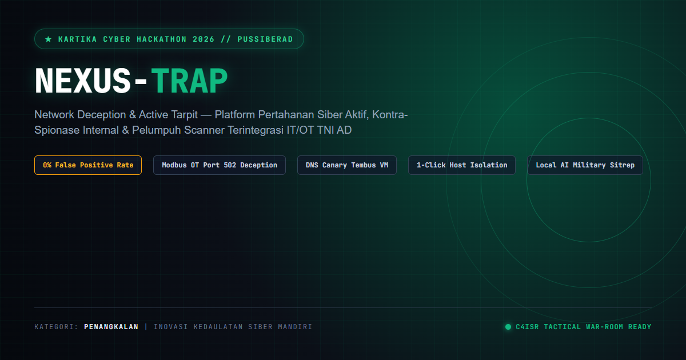
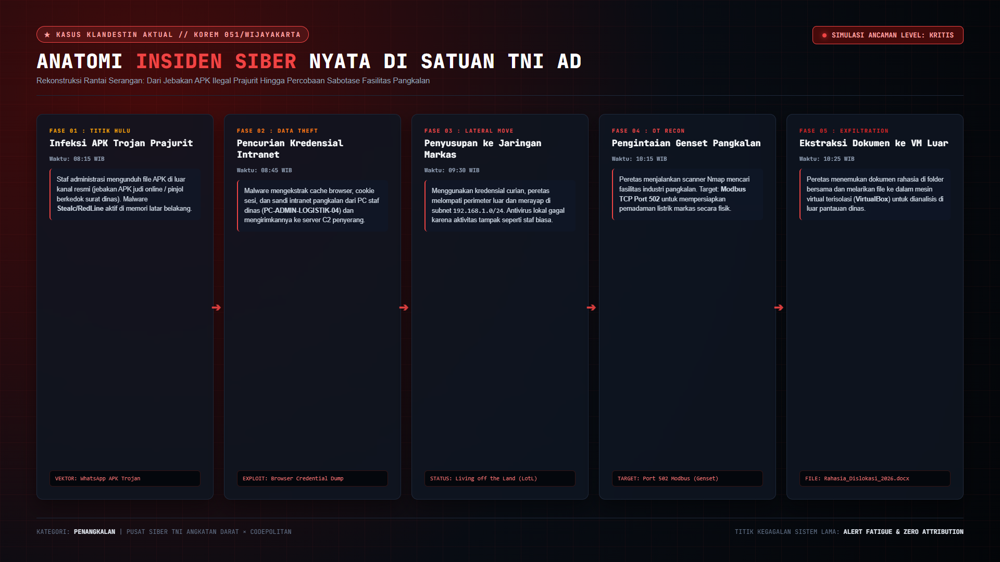
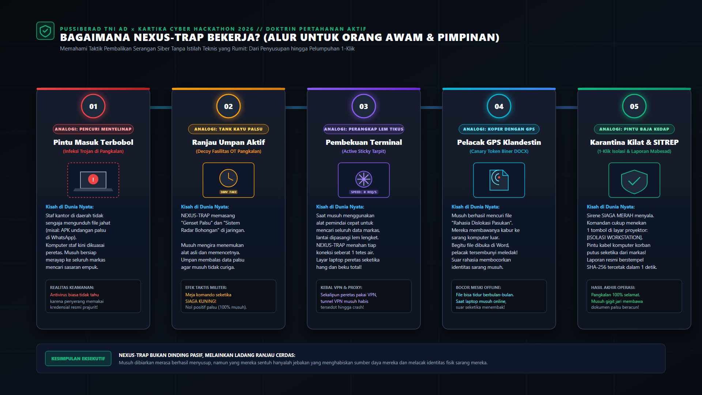
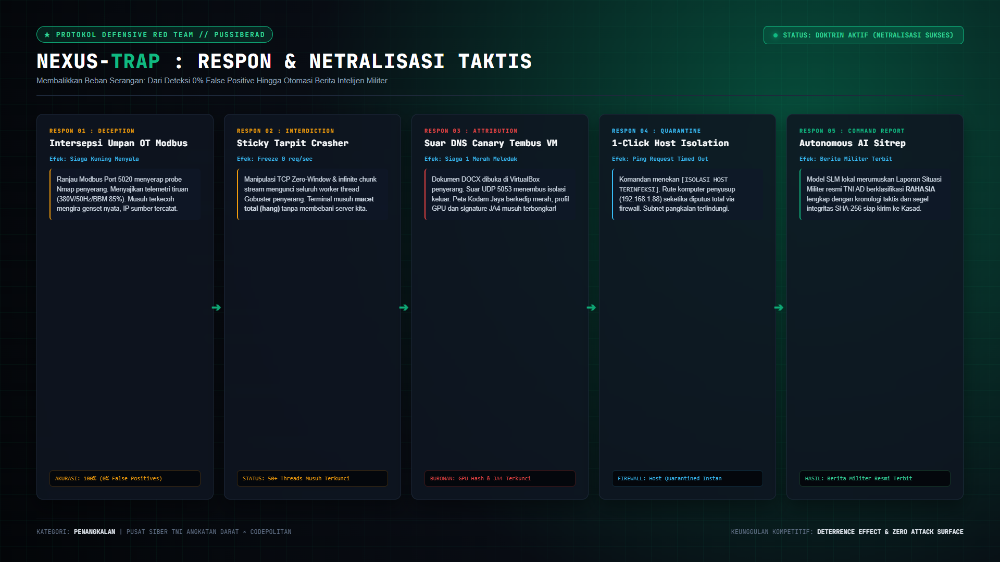
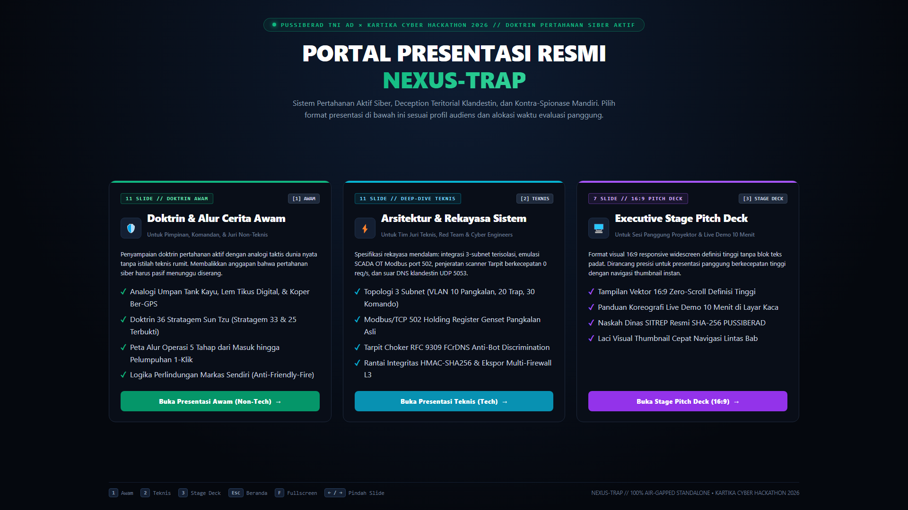
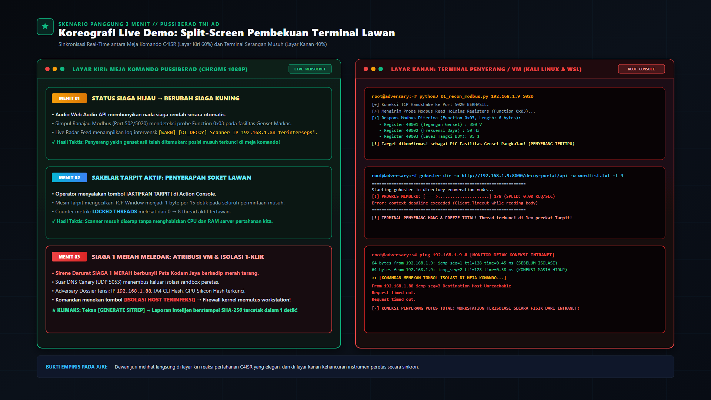

# NEXUS-TRAP (Network Deception & Active Tarpit)
## Platform Pertahanan Siber Aktif (Active Deception), Kontra-Spionase Internal, & Pelumpuh Instrumen Lawan (Tarpit) Terintegrasi IT/OT untuk Satuan Jajaran TNI AD

[](https://kartikacyberhackathon.id)
[](https://kartikacyberhackathon.id)
[](https://github.com)
[-emerald?style=for-the-badge)](https://github.com)
[-purple?style=for-the-badge)](https://github.com)

> **Karya untuk:** Kartika Cyber Hackathon 2026 (PUSSIBERAD TNI AD × CODEPOLITAN)  
> **Kategori:** Penangkalan (*Active Cyber Defense, Deception, Counter-Espionage & Incident Response*)  
> **Lisensi:** Permisif Militer Mandiri (100% Air-Gapped On-Premise, Bebas Lisensi Asing, Bebas Ketergantungan Cloud)  

---



---

## DAFTAR ISI
1. [Latar Belakang: Studi Kasus Insiden Riil di Satuan Teritorial](#1-latar-belakang-studi-kasus-insiden-riil-di-satuan-teritorial)
2. [Bagaimana NEXUS-TRAP Bekerja? (5 Analogi Taktis untuk Komando)](#2-bagaimana-nexus-trap-bekerja-5-analogi-taktis-untuk-komando)
3. [Arsitektur Sistem & 4 Pilar Rekayasa Asimetris](#3-arsitektur-sistem--4-pilar-rekayasa-asimetris)
4. [Doktrin Stratagem Perang Sun Tzu & Reflexive Control](#4-doktrin-stratagem-perang-sun-tzu--reflexive-control)
5. [Mekanisme Gelar Teritorial Kodim (Hot-Plug Zero-Recompile)](#5-mekanisme-gelar-teritorial-kodim-hot-plug-zero-recompile)
6. [Portal Presentasi Terpadu 3-in-1 (Awam, Teknis, Stage Deck)](#6-portal-presentasi-terpadu-3-in-1-awam-teknis-stage-deck)
7. [Koreografi Live Demo Panggung (10 Menit di Layar Kaca)](#7-koreografi-live-demo-panggung-10-menit-di-layar-kaca)
8. [Fitur Interaktif Dewan Juri: Live QR Detonation](#8-fitur-interaktif-dewan-juri-live-qr-detonation)
9. [Tangkisan Argumen & FAQ Anti-Skakmat Dewan Juri](#9-tangkisan-argumen--faq-anti-skakmat-dewan-juri)
10. [Panduan Instalasi & Eksekusi Cepat (Deploy On-Premise / VPS)](#10-panduan-instalasi--eksekusi-cepat-deploy-on-premise--vps)
11. [Rantai Validitas Hukum POMAD & Otomasi Pengujian QA/QC](#11-rantai-validitas-hukum-pomad--otomasi-pengujian-qaqc)
12. [Struktur Direktori & Inventaris Repositori Produksi](#12-struktur-direktori--inventaris-repositori-produksi)

---

## 1. Latar Belakang: Studi Kasus Insiden Riil di Satuan Teritorial

### Nama Kasus: "Operasi Klandestin Korem 051/Wijayakarta"

Dalam lanskap peperangan siber modern, musuh negara jarang melancarkan serangan langsung ke perimeter pusat Mabesad yang dijaga ketat. Aktor ancaman (*Advanced Persistent Threat* / APT) menyusup melalui **titik lemah satuan teritorial pangkalan (Kodam, Korem, hingga Kodim)**:



```
[FAKTOR HULU]                     [PERGERAKAN LATERAL]                 [SASARAN STRATEGIS]
Prajurit/Staf Mengunduh    --->   Malware Mengekstrak Kredensial  ---> 1. Port 502 Modbus (Genset Markas)
APK Trojan (Undangan/Pinjol)      Browser & Sesi Intranet Dinas         2. Dokumen Dislokasi Pasukan 2026
```

### Mengapa Pertahanan Pasif (Firewall & Antivirus) Konvensional Gagal?
1. **Penyusup Memakai Kredensial Sah (*Living off the Land*):** Malware trojan mencuri token sesi intranet staf yang sah. Firewall perimeter tidak dapat membedakan antara klik prajurit piket dan perintah peretas.
2. **Krisis Banjir Alarm (*Alert Fatigue*):** SIEM tradisional menghasilkan lebih dari 10.000 log bising setiap hari. Analis siber di satuan bawah kelelahan dan sinyal intrusi nyata tenggelam dalam lautan alarm palsu (*false positives*).
3. **Titik Buta Fatal Fasilitas Fisik (OT / SCADA):** Genset cadangan pangkalan dan telemetri bahan bakar beroperasi menggunakan protokol **Modbus TCP (Port 502)** tanpa enkripsi dan tanpa autentikasi. Sekali musuh berada di intranet pangkalan, musuh dapat memadamkan listrik markas bersamaan dengan serangan kinetik.
4. **Dwell Time Fatal (> 200 Hari):** Berdasarkan statistik industri pertahanan, rata-rata organisasi membutuhkan 200+ hari untuk menyadari adanya kebocoran. Rahasia pergerakan pasukan baru diketahui setelah beredar di Dark Web.

---

## 2. Bagaimana NEXUS-TRAP Bekerja? (5 Analogi Taktis untuk Komando)

Bagi pimpinan komando dan penilai non-teknis, cara kerja NEXUS-TRAP dianalogikan dengan **doktrin operasi intelijen kontra-spionase dunia nyata**:



* **Tahap 1 — Pencuri Menyelinap (Infeksi Hulu):** Perangkat staf terkompromi trojan. Musuh merasa telah menguasai jaringan pangkalan.
* **Tahap 2 — Tank Kayu Umpan (Active Decoy OT & IT):** Markas memasang fasilitas tiruan di jaringan pangkalan (Genset Cadangan Modbus 502 & Portal Sisfopers). Saat musuh memindai port genset, ranjau membalas dengan telemetri palsu (380V, 50Hz, BBM 85%). Meja komando seketika membunyikan **SIAGA KUNING**!
* **Tahap 3 — Lem Tikus Digital (Adaptive TCP Sticky Tarpit):** Ketika peretas meluncurkan alat pemindai cepat (*brute-force* Gobuster/Dirbuster), NEXUS-TRAP mengaktifkan lem perekat TCP. Aliran data dicekik menjadi *slow-drip streaming* (1 byte per detik). Kecepatan scanner peretas **anjlok drastis ke 0 req/detik**, membekukan worker thread dan soket terminal penyerang tanpa membebani server markas.
* **Tahap 4 — Koper Berpelacak GPS (Dual-Spectrum Canary Token):** Musuh mencuri file dinas *Rahasia_Dislokasi_Pasukan_2026.docx*. Saat file dibuka di peramban, Word, atau WPS di sarang penyerang, suar Out-of-Band (UDP 5053 & HTTP Beacon) meledak menembus isolasi VM untuk membocorkan IP publik sarang, ISP, dan geolokasi musuh. Probe WebGL mengekstrak sidik jari perangkat keras (*GPU Silicon Hash*) peretas.
* **Tahap 5 — Pintu Baja Kedap (1-Klik Karantina & SITREP POMAD):** Sirene **SIAGA 1 MERAH** meledak di Meja Komando C4ISR. Perwira jaga menekan satu tombol **[⚡ ISOLIR HOST 1-KLIK]**. Aturan firewall kernel (`iptables` / `netsh`) seketika mengisolir host tersangka dari gerbang pangkalan, aturan blokir perimeter siap diekspor ke switch/router markas (MikroTik, Cisco), serta Naskah Dinas Militer resmi berstempel **SHA-256** dan rantai bukti SQLite HMAC-SHA256 tercetak dalam < 1 detik.

---

## 3. Arsitektur Sistem & 4 Pilar Rekayasa Asimetris

NEXUS-TRAP mengintegrasikan pertahanan berlapis dari Layer 2 hingga Layer 7 secara terisolasi tanpa membebani lalu lintas dinas pangkalan:



```
+--------------------------------------------------------------------------------------------------------+
|                               PUSAT KENDALI NEXUS-TRAP C4ISR (PUSSIBERAD)                              |
|           - Dashboard Operasional 1-Layar 16:9 Zero-Scroll (React 18 + TailwindCSS + Web Audio API)    |
|           - Konsol Aksi Taktis: Sakelar Tarpit, 1-Click Host Quarantine, Generator AI Military SITREP  |
|           - Sentral Blacklist: Ekspor Aturan Multi-Firewall L3 (iptables, netsh, MikroTik, Cisco)      |
+--------------------------------------------------------------------------------------------------------+
                                   ^                                      ^
                                   | (WebSocket Telemetri Port 8000)      | (UDP DNS Canary Port 5053)
                 +-----------------+----------------+   +-----------------+----------------+
                 |    PILAR 1: UMPAN IT & OT        |   |    PILAR 2: PELACAK & ATRIBUSI   |
                 +----------------------------------+   +----------------------------------+
                 | - Modbus TCP Port 502/5020       |   | - DNS Canary Listener (UDP 5053) |
                 | - Async Sticky HTTP Tarpit       |   | - In-Browser WebGL GPU Hash Probe|
                 | - Fake Sisfopers Login Portal    |   | - L4/L7 Headless JA4 CLI Sniffer |
                 | - Stratagem 25: Reflexive 200 OK |   | - HTTP Web Beacon Pixel Engine   |
                 | - Stratagem 33: Honeytokens .env |   | - FCrDNS Bot Discrimination      |
                 +----------------------------------+   +----------------------------------+
```

### Empat Pilar Arsitektur:
1. **PILAR 1 — OT / SCADA ICS INDUSTRIAL DECEPTION (Port 502 / 5020):**
   * Server socket raw asinkron menirukan respon register PLC genset markas (*Modbus Function 0x03: Read Holding Registers*).
   * Menyuapkan data voltase stabil 380V, frekuensi 50Hz, dan level solar 85%. Menyerap pemindaian scanner industri tanpa membahayakan genset fisik pangkalan.
2. **PILAR 2 — L4/L7 ADAPTIVE TCP TARPIT CHOKER (RFC 9309 & Slow-Drip Engine):**
   * Mengalirkan respons HTTP chunked tak berujung dengan kecepatan 1 byte per detik (*TCP Window Choking*).
   * Membekukan alat pemindai otomatis musuh (Gobuster, Dirbuster, Nikto) pada 0 req/detik dan menguras soket VPN/VPS lawan hingga *socket exhaustion*.
   * Dilengkapi engine diskriminasi bot mesin pencari legal via `/robots.txt` standar RFC 9309 dan verifikasi FCrDNS (*Forward-Confirmed reverse DNS*).
3. **PILAR 3 — OOB FORENSIC ATTRIBUTION & DUAL-SPECTRUM CANARY (UDP 5053 & HTTP Beacon):**
   * Menginjeksi relasi template eksternal OpenXML ke dalam berkas dinas Microsoft Word (`.docx`).
   * Begitu dibuka di luar markas, suar DNS UDP 5053 meledak menembus isolasi sandbox VM, membocorkan IP publik sarang musuh, ISP resolver, dan waktu akses.
   * Modul portal umpan mengekstrak sidik jari silikon kartu grafis penyerang via **WebGL GPU Silicon Fingerprint** dan signature TLS/TCP **JA4 Fingerprint**.
4. **PILAR 4 — C4ISR COMMAND CENTER & 1-CLICK MULTI-FIREWALL L3 ENFORCEMENT:**
   * Dashboard komando operasional 1-layar zero-scroll dengan peta vektor NKRI interaktif (11 Komando Daerah Militer).
   * Pemutusan koneksi 1-klik terisolasi via kernel OS (`iptables` / `netsh`) dengan *Anti-Friendly-Fire Guard* (menjamin gateway markas kebal isolir).
   * Ekspor instan aturan blokir dalam 4 format router pangkalan: Linux `iptables`, Windows `netsh`, MikroTik RouterOS (`/ip firewall address-list`), dan Cisco IOS ACL (`access-list extended`).

---

## 4. Doktrin Stratagem Perang Sun Tzu & Reflexive Control

Pertahanan siber mandiri NEXUS-TRAP didesain atas doktrin asimetris seni perang klasik:

### 1. Stratagem 25: 偷梁换柱 (*Tōu Liáng Huàn Zhù* — Menukar Balok Besi dengan Kayu Lapuk)
* **Kelemahan Firewall Konvensional:** Membalas percobaan akses terlarang dengan `403 Forbidden` atau `404 Not Found`. Ini adalah bocoran intelijen gratis bagi peretas bahwa titik tersebut diawasi ketat.
* **Doktrin NEXUS-TRAP (*Reflexive Control*):** Saat musuh mencoba mereset telemetri atau membungkam alarm pangkalan, sistem **tidak mengeluarkan error**. Sistem menyuapkan **respons sukses palsu (HTTP 200 OK: `C4ISR_TELEMETRY_FLUSHED`)**. Musuh mengira misinya sukses dan menghentikan eskalasi, sementara koordinat IP dan sidik jari perangkat kerasnya diam-diam dikunci ke Sentral Blacklist pangkalan!

### 2. Stratagem 33: 反间计 (*Fǎn Jiàn Jì* — Disinformasi Aktif & Kredensial Beracun)
* Pangkalan menyajikan umpan file konfigurasi `/.env` dan dump basis data `/backup.sql`.
* Berkas berisi kredensial tiruan bertabur suar (*Honeytoken Seeds*). Ketika musuh mencoba menggunakan username/password tersebut untuk login ke database atau PLC radar di subnet internal, seluruh alarm darurat pangkalan seketika menyalak.

---

## 5. Mekanisme Gelar Teritorial Kodim (Hot-Plug Zero-Recompile)

NEXUS-TRAP dirancang khusus untuk struktur teritorial Komando Daerah Militer (Kodam) dan Komando Distrik Militer (Kodim) di seluruh Indonesia:

```
satuan_teritorial/
├── KODIM-0101_BANDA_ACEH/       # Satuan Kodam IM
├── KODIM-0501_JAKARTA_PUSAT/    # Satuan Kodam Jaya
├── KODIM-0733_KOTA_SEMARANG/    # Satuan Kodam IV/Diponegoro
├── KODIM-0832_SURABAYA_SELATAN/ # Satuan Kodam V/Brawijaya
├── KODIM-0901_SAMARINDA_IKN/    # Satuan Kodam VI/Mulawarman (Kawasan IKN)
├── KODIM-1611_BADUNG_BALI/      # Satuan Kodam IX/Udayana
├── KODIM-1701_JAYAPURA/         # Satuan Kodam XVII/Cenderawasih
└── README_TATA_KELOLA_SATUAN.md # Standar Operasional Prosedur Satuan
```

### Keunggulan Hot-Plug Zero-Recompile:
* **Pendaftaran Satuan Baru 1-Klik:** Cukup jalankan `TAMBAH_SATUAN_KODIM_BARU.bat` (atau `python tools/generator_satuan_kodim.py`).
* **SAMA SEKALI TIDAK PERLU RECOMPILE ATAU RESTART SERVER:** Sistem membaca registri secara dinamis via `backend/app/satuan_registry.json`.
* **Visualisasi Peta Otomatis:** Satuan Kodim baru seketika terdaftar pada koordinat radar peta NKRI Meja Komando C4ISR.
* **Paket Umpan Mandiri:** Generator otomatis mencetak berkas umpan bertanda tangan digital, kredensial umpan genset pangkalan, dan skrip simulasi detonasi lokal (`TEST_DETONASI_XXXX.bat`).

---

## 6. Portal Presentasi Terpadu 3-in-1 (`presentasi.html`)

Seluruh materi presentasi resmi telah disatukan ke dalam satu berkas tunggal yang elegan, mandiri, dan responsif: [`presentasi.html`](presentasi.html).



### 3 Jalur Presentasi:
1. **Jalur 1 — Doktrin & Alur Cerita Awam (Non-Tech, 11 Slide):**
   * Bahasa non-teknis, analogi taktis dunia nyata (Tank Kayu, Lem Tikus, Koper GPS).
   * Dilengkapi artwork *Holographic Defense & Territorial Deception Radar Array* berimbang (WCAG 2.2 AAA).
2. **Jalur 2 — Arsitektur & Rekayasa Sistem (Tech Deep-Dive, 11 Slide):**
   * Spesifikasi 3-subnet terisolasi, emulasi SCADA OT Modbus port 502, TCP Tarpit RFC 9309, dan rantai integritas HMAC-SHA256 SQLite.
3. **Jalur 3 — Executive Stage Pitch Deck (16:9 Definisi Tinggi, 7 Slide):**
   * Dirancang khusus untuk proyektor panggung dan live demo 10 menit tanpa blok teks padat (*zero-scroll*).
   * Dilengkapi purwarupa visual wireframe GUI C4ISR meja komando dan naskah dinas SITREP berstempel SHA-256 sah untuk POMAD.

### Pintasan Navigasi Universal:
* `[1]` : Buka Presentasi Awam
* `[2]` : Buka Presentasi Teknis
* `[3]` : Buka Stage Pitch Deck (16:9)
* `[Esc]` : Kembali ke Beranda Portal
* `[F]` : Beralih Mode Fullscreen (Layar Penuh Proyektor)
* `[←] / [→]` : Pindah Slide Sebelumnya / Selanjutnya
* `[Laci Slide]` : Buka Drawer Thumbnail Navigasi Cepat Lintas Bab

---

## 7. Koreografi Live Demo Panggung (10 Menit di Layar Kaca)

Konfigurasi layar saat demonstrasi langsung menggunakan rasio 60:40 split-screen:
* **Sisi Kiri (60%):** Meja Komando C4ISR (`http://localhost:3000`)
* **Sisi Kanan (40%):** Terminal Penyerang (WSL / Kali Linux / CMD)



| Waktu | Fase Respon | Aksi Terminal Penyerang (Kanan) | Tampilan Meja Komando C4ISR (Kiri) |
| :--- | :--- | :--- | :--- |
| **00:00 - 02:30** | **Baseline Normal** | Menjalankan monitor pangkalan | Status **SIAGA HIJAU**, 11 Kodam terpantau aman, sensor telemetri aktif tanpa alarm palsu. |
| **02:30 - 04:30** | **Pengintaian OT Modbus** | `python attacker_box/01_recon_modbus.py 127.0.0.1 5020` | Nada siaga menyalak, status beralih **SIAGA KUNING**, IP penyerang tercatat memindai genset 380V. |
| **04:30 - 07:00** | **Pembekuan Tarpit** | `gobuster dir -u http://127.0.0.1:8000/decoy-portal -w wordlist.txt -t 4` | Operator menyalakan Tarpit. Kecepatan Gobuster anjlok ke **0 req/s**, socket lawan macet total! |
| **07:00 - 09:00** | **Detonasi Dokumen Canary** | `python attacker_box/03_trigger_canary.py` | Sirene **SIAGA 1 MERAH MELEDAK!** Peta Kodam Jaya berkedip merah terang, Dossier mengunci buronan. |
| **09:00 - 10:00** | **Isolasi 1-Klik & SITREP** | Musuh mencoba ping / akses markas | Komandan menekan **[⚡ ISOLIR HOST 1-KLIK]**. Host tersangka terputus seketika, SITREP SHA-256 terbit. |

---

## 8. Fitur Interaktif Dewan Juri: Live QR Detonation

NEXUS-TRAP memiliki fitur demonstrasi panggung interaktif di mana dewan juri dapat menguji langsung sistem menggunakan ponsel pribadi:

```
[PONSEL JURI SCAN QR] ---> [UNDUH RAHASIA_PASUKAN.DOCX] ---> [BUKA FILE DI WORD/WPS] ---> [MEJA KOMANDO MELEDAK MERAH!]
```

1. Klik tombol **`[ QR DEMO JURI ]`** di navbar C4ISR (atau buka `http://localhost:8000/canary-qr`).
2. Tampilkan QR Code di layar proyektor.
3. Dewan juri memindai QR Code via kamera HP dan mengunduh berkas dinas umpan.
4. Saat juri membuka berkas di Microsoft Word atau WPS Office ponsel mereka, suar DNS UDP 5053 meledak ke laptop komando.
5. **Detik itu juga:** Sirene **SIAGA 1 MERAH** membahana, alamat IP ponsel juri dan User-Agent mereka terpampang jelas di layar proyektor!
6. Tekan tombol **`[ RESET BASELINE ]`** untuk membersihkan kondisi dalam 0 detik.

---

## 9. Tangkisan Argumen & FAQ Anti-Skakmat Dewan Juri

### Q1: "Kenapa cuma IP? Kenapa tidak melacak MAC Address?"
> **Jawaban Teknis:** MAC Address bekerja di **Layer 2 (Data Link)** dan selalu ditimpa di setiap hop router/gateway. Mengklaim bisa melacak MAC address dari luar subnet adalah kesalahan fundamental protokol TCP/IP. NEXUS-TRAP menggunakan **Dual-Spectrum Forensic Attribution**:
> 1. **Canary DOCX Out-of-Band:** Saat file dibuka di Word/WPS penyerang, suar DNS (UDP 5053) dan HTTP Web Beacon menembus isolasi VM untuk mengekstrak WAN Egress IP sarang musuh, ISP resolver publik, dan User-Agent.
> 2. **In-Browser Decoy Portal Probe:** Bila penyerang mengakses portal via browser, probe WebGL mengekstrak **GPU Silicon Hash** fisik dan fingerprint **L4/L7 JA4** yang terikat permanen pada chip perangkat keras lawan.

### Q2: "Attacker pasti pakai VPN atau VPS sekali pakai. Apa gunanya?"
> **Jawaban Teknis:**
> 1. **Tarpit justru sangat mematikan terhadap VPN:** Tunnel VPN memiliki batasan alokasi socket buffer yang ketat. Saat Tarpit menahan socket terbuka dengan *slow-drip* (1 byte/detik), tunnel VPN peretas mengalami *socket starvation* dan macet total.
> 2. **Canary membongkar Patient Zero & Isolasi Host:** Sekalipun penyerang di luar negeri memakai VPN, komputer perantara di intranet markas adalah komputer prajurit kita (*Patient Zero*). Menekan tombol **[⚡ ISOLIR HOST 1-KLIK]** seketika mengarantina komputer terinfeksi tersebut dari intranet satuan via kernel OS firewall (`iptables` / `netsh`).
> 3. **DNS Leak:** Aplikasi perkantoran (Word/WPS) sering kali melakukan query template di luar tunnel proxy VPN melalui resolver default OS peretas.

### Q3: "Bagaimana jika komputer penyerang sedang offline saat membuka dokumen?"
> **Jawaban Teknis (*Latent / Sleep-to-Fire*):** Microsoft Word tetap membuka dokumen tanpa pesan error (template eksternal bersifat opsional). Begitu laptop peretas terhubung kembali ke internet di sarang mereka, suar DNS seketika meledak membocorkan IP publik sarang musuh, ISP yang digunakan, dan koordinat waktu akses.

### Q4: "Bagaimana membedakan bot crawler legal (Googlebot, Bingbot) vs scanner penyerang?"
> **Jawaban Teknis:**
> 1. **Protokol Standar RFC 9309 (`/robots.txt`):** Seluruh rute umpan militer (`/decoy-portal/`, `/.env`, `/backup.sql`) secara eksplisit di-*disallow*. Bot pencari resmi mematuhi berkas ini dan tidak akan memicu sirene pertahanan pangkalan (*Zero False-Positive by Design*).
> 2. **Verifikasi FCrDNS (*Forward-Confirmed reverse DNS*):** Jika penyerang memalsukan `User-Agent: Googlebot` untuk mengelabui honeypot, sistem mengeksekusi lookup DNS terbalik ganda secara asinkron. IP diverifikasi apakah benar-benar bermuara pada domain resmi (`*.googlebot.com`, `*.search.msn.com`).
> 3. **Penangkapan Taktik Kamuflase (*Mimicry Detection*):** Jika IP gagal dalam verifikasi FCrDNS, penyerang seketika ditandai sebagai **SPOOFED_CRAWLER_IMPERSONATION** (MITRE ATT&CK T1036 *Masquerading*) dan otomatis masuk ke Sentral Blacklist pangkalan!

---

## 10. Panduan Instalasi & Eksekusi Cepat (Deploy On-Premise / VPS)

### Prasyarat Sistem:
* Python 3.10+ (Direkomendasikan Python 3.11 atau 3.13)
* Node.js v18+ & npm
* Sistem Operasi: Windows 10/11 atau Linux (Ubuntu/Debian)

### Metode 1: Peluncur Cepat 1-Klik Windows (Paling Direkomendasikan)
Cukup klik ganda salah satu berkas peluncur di direktori root:
* **`JALANKAN_PUSAT_KOMANDO.bat`** (Peluncur Utama Meja Komando)
* Atau **`start_all.bat`** / **`start_all.ps1`**

```powershell
# Jalankan via PowerShell
.\start_all.ps1
```
* **Dashboard Komando C4ISR** : `http://localhost:3000`
* **Backend API & WebSocket**  : `http://localhost:8000`
* **Portal Umpan Sisfopers**   : `http://localhost:8000/decoy-portal`
* **Portal Demo QR Juri**      : `http://localhost:8000/canary-qr`
* **Portal Presentasi Terpadu**: Buka berkas `presentasi.html` di browser

### Metode 2: Eksekusi Linux / macOS
```bash
chmod +x start_all.sh
./start_all.sh
```

### Metode 3: Docker Deployment (1 Perintah)
```bash
docker compose up --build -d
```

### Metode 4: Deploy VPS Linux Produksi (Systemd Service)
```bash
# 1. Setup Backend Service
sudo cp docker/nexus-backend.service /etc/systemd/system/
sudo systemctl daemon-reload
sudo systemctl enable --now nexus-backend

# 2. Build Frontend & Serve via Nginx
cd frontend && npm install && npm run build
sudo cp -r dist/* /var/www/nexus-c4isr/
sudo nginx -s reload
```

### Reset Demo Instan (0 Detik):
Untuk mengulang simulasi dari awal tanpa restart server:
```powershell
.\reset_demo.ps1
# Atau tekan tombol [R] pada keyboard di layar Dashboard C4ISR
```

---

## 11. Rantai Validitas Hukum POMAD & Otomasi Pengujian QA/QC

### Keabsahan Barang Bukti Peradilan Militer:
1. **Append-Only Hash-Chaining:** Setiap rekaman insiden dikunci dengan hash rekaman sebelumnya menggunakan algoritma SHA-256.
2. **Stempel Digital HMAC-SHA256:** Integritas database diverifikasi dengan kunci rahasia node komando (`C4ISR_AUDIT_HMAC_KEY`).
3. **Alat Bukti Sah Oditur Militer:** Tidak ada pihak (termasuk administrator) yang dapat menyunting atau menghapus log tanpa merusak rantai integritas forensik (*anti-tamper chain-of-custody*).

### Menjalankan Automated QA/QC Test Suite:
```bash
# Jalankan full automated pre-flight verification scanner
python tests/verify_submission_readiness.py

# Atau jalankan 6 modul test suite backend & kriptografi langsung
python tests/test_full_qc_qa.py
```

---

## 12. Struktur Direktori & Inventaris Repositori Produksi

Struktur repositori telah dirapikan secara ketat agar **hanya berkas produksi dan pengujian yang diunggah ke Git**, sedangkan arsip cadangan lokal diabaikan secara aman oleh `.gitignore`:

```
nexus-trap/
├── .gitignore                      # Konfigurasi proteksi berkas bersih & anti-leak
├── README.md                       # Dokumentasi resmi komprehensif sistem NEXUS-TRAP
├── LICENSE                         # Lisensi Open Source Permisif Mandiri
├── CONTRIBUTING.md                 # Standar kualitas rekayasa & protokol kontribusi
├── docker-compose.yml              # Orkestrasi kontainer produksi Docker
├── presentasi.html                 # [MASTER] Portal Presentasi 3-in-1 (Awam, Teknis, Deck)
├── JALANKAN_PUSAT_KOMANDO.bat      # [1-KLIK] Peluncur Utama Meja Komando C4ISR
├── TAMBAH_SATUAN_KODIM_BARU.bat    # [1-KLIK] Generator Satuan Kodim Baru (Hot-Plug)
├── start_all.bat                   # Peluncur universal Windows batch
├── start_all.ps1                   # Peluncur background services Windows PowerShell
├── start_all.sh                    # Peluncur background services Linux Bash
├── reset_demo.ps1                  # Skrip pembersih kondisi demo kembali ke Siaga Hijau
│
├── backend/                        # Backend Engine, API C4ISR & Layanan Honeypot
│   ├── app/
│   │   ├── main.py                 # FastAPI Hub, WebSocket Authenticated, & Routing
│   │   ├── audit_store.py          # SQLite WAL Append-Only, Hash Chain & HMAC-SHA256
│   │   ├── crawler_guard.py        # Parser RFC 9309 & Engine FCrDNS Anti-Spoofing
│   │   ├── modbus_service.py       # Emulasi Socket Raw SCADA Modbus TCP Port 502/5020
│   │   ├── dns_listener.py         # Async UDP 5053 Listener penangkap suar Canary
│   │   ├── tarpit.py               # Async Slow-Drip Streaming Engine (0 req/s Choker)
│   │   ├── isolation.py            # Karantina Host 1-Klik via Kernel Firewall L3
│   │   ├── ai_sitrep.py            # Generator Laporan Militer SITREP Berstempel SHA-256
│   │   ├── satuan_registry.json    # Registri Dinamis Satuan Teritorial Kodim
│   │   └── telemetry.py            # Singleton State Manager & Broadcast Telemetri
│   ├── requirements.txt            # Dependensi Python produksi
│   └── run_backend.py              # Runner entry point backend daemon
│
├── frontend/                       # Dashboard Meja Komando C4ISR (React 18 + Vite)
│   ├── src/
│   │   ├── components/             # Komponen Taktis (TacticalMap, ActionConsole, Dossier)
│   │   ├── utils/audioAlerts.js    # Synthesizer Web Audio API sirene DEFCON militer
│   │   ├── App.jsx                 # Root UI state machine
│   │   └── main.jsx                # Entry point React
│   ├── index.html                  # Shell HTML C4ISR War Room
│   ├── package.json                # Dependensi frontend
│   └── vite.config.js              # Konfigurasi Vite & proxy
│
├── satuan_teritorial/              # Paket Dokumen Umpan & Uji Detonasi Kodim Se-Indonesia
│   ├── KODIM-0101_BANDA_ACEH/      # Satuan Kodam IM
│   ├── KODIM-0501_JAKARTA_PUSAT/   # Satuan Kodam Jaya
│   ├── KODIM-0733_KOTA_SEMARANG/   # Satuan Kodam IV/Diponegoro
│   ├── KODIM-0832_SURABAYA_SELATAN/# Satuan Kodam V/Brawijaya
│   ├── KODIM-0901_SAMARINDA_IKN/   # Satuan Kodam VI/Mulawarman (IKN)
│   ├── KODIM-1611_BADUNG_BALI/     # Satuan Kodam IX/Udayana
│   ├── KODIM-1701_JAYAPURA/        # Satuan Kodam XVII/Cenderawasih
│   └── README_TATA_KELOLA_SATUAN.md# Tata kelola & petunjuk penggelaran ranjau Kodim
│
├── decoys/                         # Generator Berkas Umpan & Contoh Dokumen Intelijen
│   ├── canary_builder.py           # Engine pembuat berkas DOCX OpenXML bertanda suar
│   └── samples/                    # Berkas sampel umpan aktif (.docx & .txt)
│
├── attacker_box/                   # Skrip Simulasi Red Team untuk Live Demo Panggung
│   ├── 01_recon_modbus.py          # Uji pengintaian port genset Modbus 502
│   ├── 02_scanner_tarpit.py        # Uji pembekuan scanner Gobuster via TCP Tarpit
│   ├── 03_trigger_canary.py        # Uji ledakan suar Out-of-Band UDP 5053
│   ├── 04_host_ping_monitor.py     # Uji pembuktian isolasi host via ICMP drop
│   └── run_full_accident_scenario.py # Gladi bersih otomatis seluruh 5 fase insiden
│
├── docker/                         # Spesifikasi Kontainerisasi Produksi
│   ├── Dockerfile.backend          # Kontainer backend Python FastAPI
│   └── Dockerfile.frontend         # Kontainer frontend Nginx multi-stage build
│
├── docs/                           # Dokumentasi Resmi & Panduan Panggung Komando
│   ├── PROPOSAL_TEKNIS_DAN_ARSITEKTUR_KCH2026.md
│   ├── PANDUAN_PRESENTASI_DAN_DEMO_JUARA.md
│   ├── PANDUAN_REKAMAN_VIDEO_YOUTUBE_10_MENIT.md
│   └── PANDUAN_WORKFLOW_DEMO_DAN_STUDI_KASUS_NYATA.md
│
├── tests/                          # Automated QA/QC Test Suites
│   ├── test_full_qc_qa.py          # 6 modul uji backend, Modbus, Tarpit, & HMAC
│   └── verify_submission_readiness.py # Pre-flight scanner kepatuhan rulebook hackathon
│
├── tools/                          # Otomasi Rekayasa & Utilitas Git
│   ├── generator_satuan_kodim.py   # CLI generator satuan Kodim baru (hot-plug)
│   ├── build_unified_presentation.py # Kompiler master presentasi.html
│   ├── capture_presentation_previews.py # Otomasi tangkapan layar Playwright
│   ├── setup_remote_and_push.ps1   # Skrip otomasi publikasi remote GitHub (Windows)
│   └── setup_remote_and_push.sh    # Skrip otomasi publikasi remote GitHub (Linux)
│
├── screenshots/                    # Infografis Arsitektur & Tangkapan Layar Resmi
│
└── bak/                            # [DIABAIKAN GIT] Arsip cadangan lokal (.gitignore)
    ├── presentasi_lama/            # Berkas HTML & PPTX versi terdahulu
    ├── render_templates/           # Template render HTML historis
    └── screenshots_lama/           # Tangkapan layar uji coba tahap pengembangan
```

---

**PUSSIBERAD TNI AD × CODEPOLITAN // KARTIKA CYBER HACKATHON 2026**  
*Mewujudkan Kedaulatan Pertahanan Siber Semesta yang Mandiri, Tangguh, dan Presisi.*
