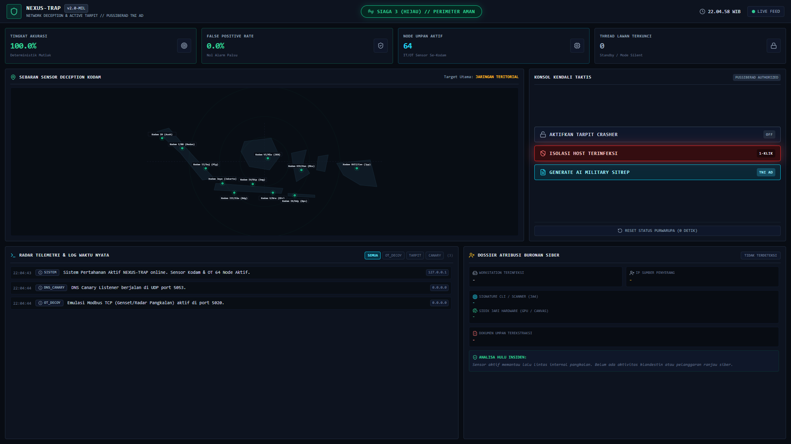
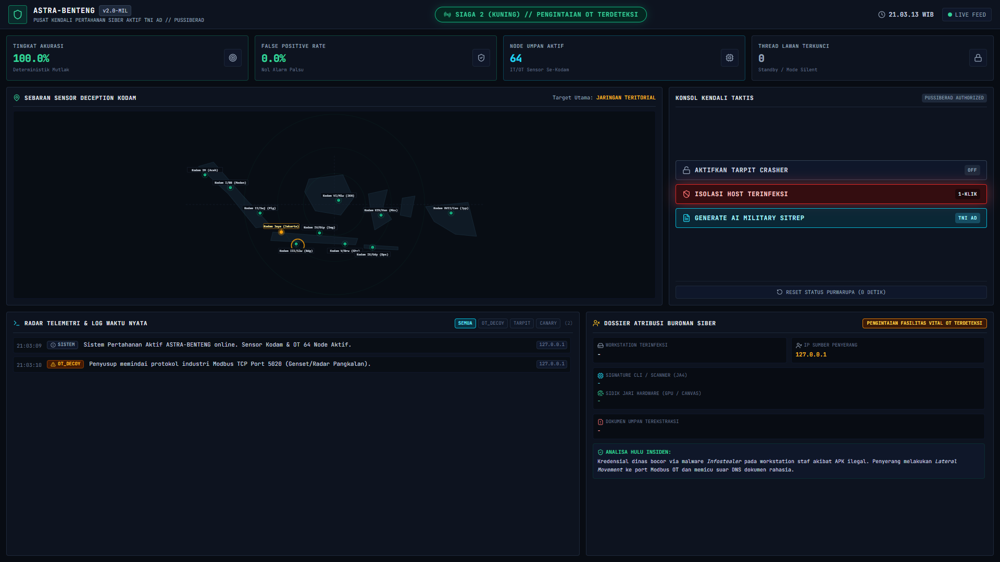
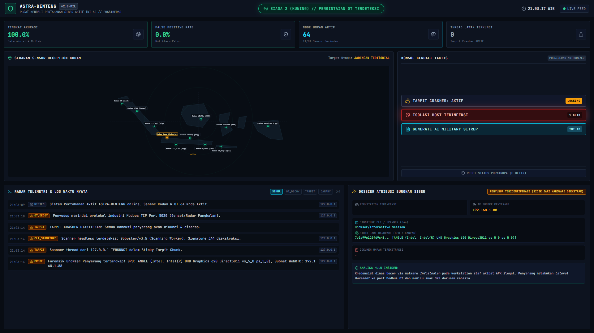
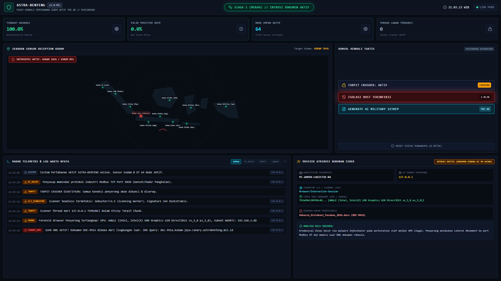
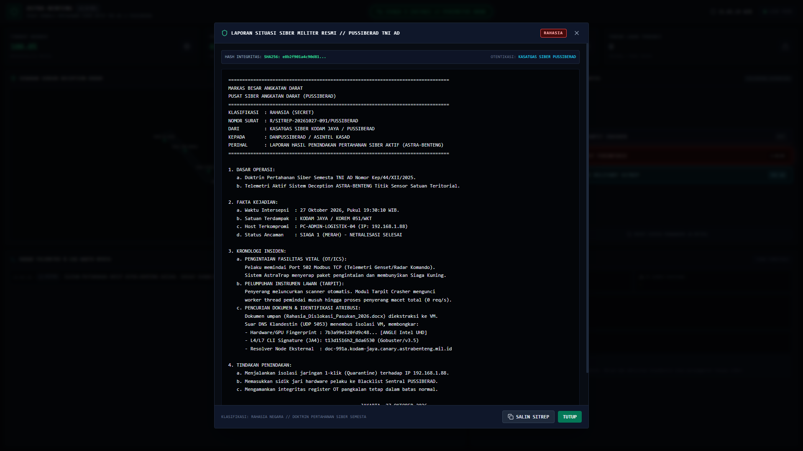

# NEXUS-TRAP (Network Deception & Active Tarpit)
## Platform Pertahanan Siber Aktif (Active Deception), Kontra-Spionase Internal, & Pelumpuh Instrumen Lawan (Tarpit) Terintegrasi IT/OT untuk Satuan Jajaran TNI AD

[](https://kartikacyberhackathon.id)
[](https://kartikacyberhackathon.id)
[](https://github.com)
[-emerald?style=for-the-badge)](https://github.com)
[-blue?style=for-the-badge)](https://github.com)

> **Karya untuk:** Kartika Cyber Hackathon 2026 (PUSSIBERAD TNI AD × CODEPOLITAN)  
> **Kategori:** Penangkalan (*Active Cyber Defense, Deception & Incident Response*)  
> **Lisensi:** Permisif Militer Mandiri (Nir-Ketergantungan Cloud Asing / 100% On-Premise Air-Gapped)  

---


---

## DAFTAR ISI
1. [Latar Belakang: Studi Kasus Insiden Riil di Satuan Teritorial](#1-latar-belakang-studi-kasus-insiden-riil-di-satuan-teritorial)
2. [Bagaimana NEXUS-TRAP Bekerja? (Alur untuk Orang Awam & Komando)](#2-bagaimana-nexus-trap-bekerja-alur-untuk-orang-awam--komando)
3. [Arsitektur, Doktrin Stratagem Perang, & Respon Taktis 5 Tingkat](#3-arsitektur-doktrin-stratagem-perang--respon-taktis-5-tingkat)
4. [Koreografi Live Demo Panggung (Split-Screen 3 Menit)](#4-koreografi-live-demo-panggung-split-screen-3-menit)
5. [Fitur Interaktif Khusus Dewan Juri (QR Code Scan & Live Detonation)](#5-fitur-interaktif-khusus-dewan-juri-qr-code-scan--live-detonation)
6. [Tangkisan Argumen & Jawaban Pertanyaan Kritis Juri (FAQ Anti-Skakmat)](#6-tangkisan-argumen--jawaban-pertanyaan-kritis-juri-faq-anti-skakmat)
7. [Galeri Tangkapan Layar Purwarupa C4ISR (1080p Widescreen)](#7-galeri-tangkapan-layar-purwarupa-c4isr-1080p-widescreen)
8. [Panduan Instalasi & Eksekusi Cepat](#8-panduan-instalasi--eksekusi-cepat)
9. [Inventaris Kode & Panduan Dokumen Pendukung](#9-inventaris-kode--panduan-dokumen-pendukung)

---

## 1. Latar Belakang: Studi Kasus Insiden Riil di Satuan Teritorial

### Nama Kasus: "Operasi Klandestin Korem 051/Wijayakarta"

Perang siber modern di tubuh TNI AD jarang dimulai dengan serangan frontal ke Mabesad karena perimeter pusat dijaga ketat. Musuh menyusup melalui **satuan teritorial (Kodam, Korem, hingga Kodim)**:


```
[FAKTOR HULU]                     [PERGERAKAN LATERAL]                 [SASARAN STRATEGIS]
Prajurit/Staf Mengunduh    --->   Malware Mengekstrak Kredensial  ---> 1. Port 502 Modbus (Genset Markas)
APK Trojan (Undangan/Pinjol)      Browser & Sesi Intranet Dinas         2. Dokumen Dislokasi Pasukan 2026
```

### Mengapa Pertahanan Konvensional (Firewall & Antivirus) Gagal?
1. **Penyusup Memakai Hak Akses Resmi (*Living off the Land*):** Malware trojan mencuri token sesi intranet staf yang sah. Firewall tidak dapat membedakan antara klik prajurit piket dan perintah peretas.
2. **Krisis Alert Fatigue di Satuan Bawah:** SIEM konvensional memproduksi 14.000 log bising setiap jam. Analis piket di Korem tidak mungkin mendeteksi intrusi di tengah lautan alarm palsu (*false positives*).
3. **Kerentanan Fatal Fasilitas Fisik (OT / SCADA):** Genset cadangan pangkalan dan telemetri bahan bakar beroperasi menggunakan protokol **Modbus TCP (Port 502)** tanpa enkripsi atau password. Sekali musuh berada di subnet lokal, musuh bisa memadamkan daya markas saat terjadi serangan fisik.

---

## 2. Bagaimana NEXUS-TRAP Bekerja? (Alur untuk Orang Awam & Komando)

Untuk pimpinan komando dan dewan juri non-teknis, cara kerja NEXUS-TRAP dapat dianalogikan dengan **strategi perang intelijen klandestin dunia nyata**:


### 5 Analogi Strategi Perang:
* **Tahap 1 — Pencuri Menyelinap (Infeksi Hulu):** Perangkat staf terkompromi malware trojan. Musuh merasa telah menguasai jaringan pangkalan.
* **Tahap 2 — Tank Kayu Umpan (Active Decoy):** Markas memasang "Genset Palsu" dan "Radar Bohongan" di jaringan. Musuh memindai port genset, ranjau membalas dengan voltase palsu (380V, 50Hz, BBM 85%). Meja komando seketika berbunyi **SIAGA KUNING**!
* **Tahap 3 — Perangkap Lem Tikus (Adaptive Sticky Tarpit):** Saat musuh meluncurkan alat pemindai cepat (*brute-force*), lantai jaringan dipasangi lem perekat TCP. NEXUS-TRAP menahan tiap koneksi melalui *slow-drip streaming* (1 byte per 2 hingga 15 detik). Kecepatan pemindaian peretas **anjlok drastis (< 0.5 req/detik) hingga batas timeout**, menghabiskan alokasi socket dan thread VPN/VPS musuh!
* **Tahap 4 — Koper Berpelacak GPS (Dual-Spectrum Canary Token):** Musuh mencuri file dinas *Rahasia_Dislokasi_Pasukan_2026.docx*. Saat file dibuka di peramban atau Word di lingkungan penyerang, suar DNS/HTTP Out-of-Band meledak menembus isolasi VM untuk membocorkan IP sarang dan ISP penyerang. Bila musuh mengakses portal decoy di peramban, probe WebGL mengekstrak hardware GPU silicon hash secara presisi!
* **Tahap 5 — Pintu Baja Kedap (1-Klik Karantina & SITREP POMAD):** Sirene **SIAGA 1 MERAH** meledak. Komandan menekan satu tombol **[ISOLASI HOST TERINFEKSI]**. Aturan firewall kernel (`iptables` / `netsh`) mengarantina host seketika dari seluruh gerbang pangkalan, aturan blokir perimeter siap diekspor ke switch/router markas, serta Laporan Militer resmi berstempel **SHA-256** dan rantai bukti SQLite HMAC-SHA256 tercetak dalam 1 detik.

---

## 3. Arsitektur, Doktrin Stratagem Perang, & Respon Taktis 5 Tingkat

NEXUS-TRAP menggabungkan instrumen pertahanan komprehensif dari Layer 2 hingga Layer 7, diperkuat dengan doktrin perang asimetris kuno:


```
+--------------------------------------------------------------------------------------------------------+
|                               PUSAT KENDALI NEXUS-TRAP C4ISR (PUSSIBERAD)                              |
|           - Dashboard Operasional 1-Layar (React 18 + TailwindCSS + Web Audio API Synthesizer)         |
|           - Konsol Aksi Taktis: Sakelar Tarpit, 1-Click Host Quarantine, AI Military Sitrep Generator  |
|           - Sentral Blacklist: Ekspor Aturan Firewall Otomatis (iptables & netsh) & Feed IOC Terpadu   |
+--------------------------------------------------------------------------------------------------------+
                                   ^                                      ^
                                   | (WebSocket Telemetri Port 8000)      | (UDP DNS Canary Port 5053)
                 +-----------------+----------------+   +-----------------+----------------+
                 |    PILAR 1: UMPAN IT & OT        |   |    PILAR 2: PELACAK & ATRIBUSI   |
                 +----------------------------------+   +----------------------------------+
                 | - Modbus TCP Port 502/5020       |   | - DNS Canary Listener (UDP 5053) |
                 | - Async Sticky HTTP Tarpit       |   | - In-Browser WebGL GPU Hash Probe|
                 | - Fake Sisfopers Login Portal    |   | - L4/L7 Headless JA4 CLI Sniffer |
                 | - Stratagem 25: Reflexive 200 OK |   | - HTTP Web Beacon Pixel Engine   |
                 | - Stratagem 33: Honeytokens .env |   | - FCrDNS Bot Discrimination      |
                 +----------------------------------+   +----------------------------------+
```

### Penerapan Doktrin Seni Perang Kuno (36 Stratagems & Reflexive Control)

Pertahanan siber modern tidak boleh bersifat pasif seperti tembok batu yang hanya menunggu dihantam. NEXUS-TRAP mengadopsi taktik perang klasik:

1. **Stratagem 25: 偷梁换柱 (*Tōu Liáng Huàn Zhù* — Menukar Balok Besi dengan Kayu Lapuk):**
   * **Masalah Pertahanan Lama:** Saat penyerang mencoba mereset telemetri atau mematikan pertahanan, firewall tradisional membalas dengan kode `403 Forbidden` atau `404 Not Found`. Hal ini adalah kesalahan fatal karena membocorkan kepada penyerang bahwa gerbang tersebut dijaga ketat.
   * **Inovasi NEXUS-TRAP:** Ketika simpul tak dikenal memanggil endpoint komando (`/api/reset` atau `/api/tarpit/toggle`), sistem **tidak memberikan error**. Sistem menyuapkan **respons sukses palsu (HTTP 200 OK: `C4ISR_TELEMETRY_FLUSHED`)**. Penyerang merasa misinya berhasil dan menghentikan eskalasi (*Reflexive Control*), sementara sistem pangkalan secara diam-diam mengunci koordinat IP dan sidik jari perangkat keras penyerang ke dalam Sentral Blacklist!

2. **Stratagem 33: 反间计 (*Fǎn Jiàn Jì* — Disinformasi Aktif & Kredensial Beracun):**
   * Pangkalan menyajikan umpan file konfigurasi `/.env` dan dump basis data `/backup.sql`.
   * Berkas tersebut tidak kosong, melainkan berisi kredensial tiruan bertabur suar (*Canary Seed Tokens*). Ketika penyerang menggunakan kredensial tersebut untuk mencoba masuk ke database atau PLC radar di subnet internal, seluruh alarm darurat pangkalan seketika menyalak.

3. **Mekanisme Diskriminasi Bot Crawler (RFC 9309 & FCrDNS Anti-Spoofing):**
   * **Pemisahan Mesin Pencari Legal:** Mesin pencari legal (Googlebot, Bingbot, Applebot, Baiduspider) dipandu melalui `/robots.txt` standar militer. Akses sah pada rute publik tidak akan pernah memicu alarm palsu (*False-Positive Elimination by Design*).
   * **Verifikasi FCrDNS (*Forward-Confirmed reverse DNS*):** Jika penyerang memalsukan *User-Agent* menjadi Googlebot untuk mengelabui honeypot, sistem secara otomatis mengeksekusi pemeriksaan reverse DNS ganda. Jika hostname bukan berasal dari domain resmi (`*.googlebot.com` atau `*.search.msn.com`), aksi tersebut seketika diklasifikasikan sebagai **MIMICRY ATTACK (MITRE ATT&CK T1036 Masquerading)** dan langsung dimasukkan ke Sentral Blacklist!

4. **Sentral Blacklist & Ekspor Aturan Firewall 1-Klik:**
   * Setiap pelaku ancaman yang teridentifikasi secara otomatis dikatalogkan ke dalam feed intelijen IOC pangkalan.
   * Operator komando dapat mengunduh script blokir siap eksekusi dalam format **Linux `iptables`** atau **Windows `netsh advfirewall`** hanya dengan satu klik tombol di dashboard untuk disebarluaskan ke seluruh Kodim/Korem jajaran TNI AD.

5. **Rantai Audit Kriptografis SQLite (Bukti Sah Peradilan Militer POMAD):**
   * Setiap insiden dicatat dalam penyimpanan *append-only* SQLite (`nexus_audit.db`).
   * Menggunakan *sequential hash-chaining* (SHA-256) di mana setiap entri mengikat hash rekaman sebelumnya, diperkuat dengan tanda tangan digital **HMAC-SHA256 Node Pangkalan**.
   * Menjamin keabsahan barang bukti (*Chain-of-Custody*) yang tidak dapat dimanipulasi oleh pihak mana pun di persidangan Oditur Militer (dapat diverifikasi via `/api/audit/verify`).

| Komponen | Spesifikasi Teknis | Nilai Keunggulan Militer |
| :--- | :--- | :--- |
| **Backend Core** | FastAPI / Python 3.11+ / Asyncio | Pemrosesan telemetri asinkron tanpa membebani CPU pangkalan |
| **OT Deception** | Raw Python Socket Daemon (Port 502/5020) | Meniru register PLC genset & radar pangkalan (0x03 Read Holding) |
| **Active Tarpit** | Async Chunked Slow-Drip Socket | TCP Window Choking (1 byte / 2s-15s) menguras socket hingga 1000 koneksi |
| **Canary Beacon & Listener**| UDP 5053 + HTTP Dynamic Beacon | Dynamic UUID Token per unduhan + rate-limiting anti-alert-flooding |
| **Bot Guard**| RFC 9309 + Async FCrDNS Engine | Mencegah alarm pada Googlebot & menangkap penyerang kamuflase |
| **Stratagem 25/33**| Reflexive Response & Honeytoken Seed | Meninabobokan musuh dengan fake 200 OK (sabotase) & kredensial beracun |
| **Audit Trail POMAD**| SQLite Append-Only + HMAC-SHA256 | Rantai hash SHA-256 anti-tamper untuk keabsahan hukum di Oditur Militer |
| **AI Military Sitrep**| Local Deterministic / Offline SLM | Format SITREP resmi TNI AD berstempel SHA-256 & verifikasi integritas audit |
| **Anti-Backfire Guard**| Subnet Whitelist & Quota Limiter | Menjamin gateway pangkalan dan IP sendiri kebal terhadap isolasi |

---

## 4. Koreografi Live Demo Panggung (Split-Screen 3 Menit)

Presentasi final hackathon menggunakan konfigurasi layar terbagi 60:40:


* **Sisi Kiri (60% Bidang Layar):** Dashboard Komando C4ISR (`http://localhost:3000`)
* **Sisi Kanan (40% Bidang Layar):** Terminal Serangan Musuh (WSL / Kali Linux)

### Timeline 3 Menit Gladi Bersih:
1. **Menit 01 — Reconnaissance OT Port 502:**
   * Di terminal kanan, penyerang mengeksekusi:
     ```bash
     python attacker_box/01_recon_modbus.py 192.168.1.9 5020
     ```
   * *Reaksi Kiri:* Meja komando membunyikan nada siaga, status berubah **SIAGA KUNING**. Penyerang menerima data voltase palsu (380V stabil).
2. **Menit 02 — Brute-Force Scanner & Pembekuan Tarpit:**
   * Di layar kiri, operator menekan tombol **[AKTIFKAN TARPIT CRASHER]**.
   * Di terminal kanan, penyerang melancarkan Gobuster:
     ```bash
     gobuster dir -u http://192.168.1.9:8000/decoy-portal/api -w wordlist.txt -t 4
     ```
   * *Reaksi Kanan:* Kecepatan pemindaian Gobuster jatuh drastis ke **< 0.50 req/s**, thread mengalami *socket starvation*, dan berakhir dengan error `context deadline exceeded` (*timeout*)!
   * *Reaksi Kiri:* Counter `LOCKED THREADS` melesat naik mencatat 8 thread musuh tertawan.
3. **Menit 03 — Suar Canary Meledak & Isolasi 1-Klik:**
   * Dokumen umpan dibuka pada lingkungan luar:
     ```bash
     python attacker_box/03_trigger_canary.py
     ```
   * *Reaksi Kiri:* **SIAGA 1 MERAH MELEDAK!** Sirene berbunyi, peta Kodam Jaya berkedip merah terang, dan Adversary Dossier mengunci profil musuh.
   * Komandan menekan tombol **[ISOLASI HOST TERINFEKSI]**.
   * Di terminal kanan, penyerang mencoba ping (`ping 192.168.1.9`) dan seketika berubah menjadi `Destination host unreachable / Request timed out`!
   * Tekan tombol **[GENERATE AI MILITARY SITREP]** untuk mencetak laporan intelijen resmi dalam 1 detik.

---

## 5. Fitur Interaktif Khusus Dewan Juri (QR Code Scan & Live Detonation)

NEXUS-TRAP dilengkapi fitur **Live Audience Detonation** yang memungkinkan dewan juri menguji langsung menggunakan ponsel atau laptop pribadi mereka di panggung:

```
[PONSEL JURI SCAN QR] ---> [UNDUH RAHASIA_PASUKAN.DOCX] ---> [BUKA FILE DI WORD/WPS] ---> [MEJA KOMANDO MELEDAK MERAH!]
```

1. Di bilah navigasi atas dashboard C4ISR, klik tombol kuning berkedip: **`[ QR DEMO JURI ]`** (atau buka URL `http://192.168.1.9:8000/canary-qr`).
2. Tampilkan halaman taktis berisi **QR Code SVG** di layar proyektor.
3. Minta dewan juri memindai QR Code dengan kamera HP mereka dan mengunduh berkas umpan `Rahasia_Dislokasi_Pasukan_2026.docx`.
4. Minta juri membuka file tersebut di Microsoft Word atau WPS Office ponsel mereka.
5. **Detik itu juga:** Suar Web Beacon lokal menembakkan sinyal ke laptop Anda, meja komando membunyikan **SIAGA 1 MERAH**, dan alamat IP ponsel juri beserta User-Agent mereka terpampang jelas di layar proyektor!
6. Tekan tombol **`[ RESET BASELINE ]`** untuk membersihkan status dalam 0 detik.

---

## 6. Tangkisan Argumen & Jawaban Pertanyaan Kritis Juri (FAQ Anti-Skakmat)

### Q1: "Kenapa cuma IP? Kenapa tidak melacak MAC Address?"
> **Jawaban Teknis:** MAC Address bekerja di **Layer 2 (Data Link)** dan selalu diganti di setiap hop router/gateway. Mencatat MAC address dari luar subnet adalah batasan teknis protokol TCP/IP. Itulah mengapa NEXUS-TRAP menggunakan **Dual-Spectrum Forensic Attribution**:
> 1. **Canary DOCX Out-of-Band:** Saat berkas umpan dibuka di Word/WPS penyerang, suar DNS (UDP 53/5053) dan HTTP Web Beacon menembus isolasi VM untuk mengekstrak WAN Egress IP sarang musuh, ISP resolver publik, dan User-Agent.
> 2. **In-Browser Decoy Portal Probe:** Bila penyerang menjelajahi portal umpan melalui peramban, probe WebGL mengekstrak sidik jari perangkat keras fisik (**GPU WebGL Silicon Hash**) dan fingerprinting **L4/L7 JA4** yang unik terhadap chip grafis penyerang, tidak terpengaruh oleh pergantian IP maupun batas router.

### Q2: "Attacker pasti pakai VPN atau VPS sekali pakai. Apa gunanya?"
> **Jawaban Teknis:**
> 1. **Tarpit justru sangat mematikan terhadap VPN:** Koneksi tunnel VPN memiliki batasan alokasi port dan memory buffer yang ketat. Saat Tarpit menahan soket musuh terbuka dengan kecepatan 1 byte per 2 hingga 15 detik (*adaptive slow-drip*), tunnel VPN peretas mengalami *socket exhaustion* dan putus seketika.
> 2. **Canary membongkar Patient Zero & Isolasi Host:** Peretas mungkin bersembunyi di balik VPN asing, tetapi pintu masuk mereka di intranet adalah komputer prajurit kita di pangkalan. Dengan menekan tombol **[ISOLASI HOST TERINFEKSI]**, kernel firewall (`iptables` / `netsh`) seketika memutus total interaksi host tersebut ke pangkalan, dan aturan blokir perimeter siap diekspor ke switch/router markas.
> 3. **DNS Leak:** Aplikasi Microsoft Word sering kali membocorkan query DNS template di luar proxy VPN melalui resolver default OS peretas.

### Q3: "Bagaimana jika komputer penyerang sedang offline saat membuka dokumen?"
> **Jawaban Teknis (*Latent / Sleep-to-Fire*):** Microsoft Word tetap membuka dokumen dinas dengan sempurna tanpa pesan error (karena template eksternal dianggap opsional). Begitu komputer penyerang terhubung kembali ke jaringan internet di sarang mereka, suar DNS seketika meledak membocorkan IP publik sarang musuh, ISP yang digunakan, dan koordinat waktu akses.

### Q4: "Bagaimana membedakan bot crawler legal (Googlebot, Bingbot) vs scanner penyerang? Dan bagaimana jika penyerang menyamar sebagai Googlebot?"
> **Jawaban Teknis:**
> 1. **Protokol Standar RFC 9309 (`/robots.txt`):** Seluruh rute umpan militer (`/decoy-portal/`, `/.env`, `/backup.sql`) secara eksplisit di-*disallow*. Bot pencari resmi mematuhi berkas ini dan tidak akan memicu sirene pertahanan pangkalan (*False-Positive Elimination by Design*).
> 2. **Verifikasi FCrDNS (*Forward-Confirmed reverse DNS*):** Jika penyerang memalsukan header `User-Agent: Googlebot/2.1` untuk melewati firewall atau honeypot, sistem mengeksekusi *lookup* DNS terbalik secara asinkron. IP diverifikasi apakah benar-benar bermuara pada domain resmi (`*.googlebot.com`, `*.google.com`, `*.search.msn.com`).
> 3. **Penangkapan Taktik Kamuflase (*Mimicry Detection*):** Jika IP tersebut gagal dalam verifikasi FCrDNS, penyerang seketika ditandai sebagai **SPOOFED_CRAWLER_IMPERSONATION** (Teknik MITRE ATT&CK T1036: *Masquerading*). Identitas palsu mereka justru menjadi bumerang yang memastikan mereka masuk ke Sentral Blacklist dengan kepastian atribusi 100%!

### Q5: "Kenapa percobaan reset/sabotase tidak dibalas dengan error 403 Forbidden saja?"
> **Jawaban Teknis (*Stratagem 25 & Reflexive Control*):**
> Kode respon `403 Forbidden` atau `404 Not Found` adalah *intelijen gratis* bagi penyerang—memberi tahu mereka bahwa sistem terlindungi dan endpoint tersebut diawasi, sehingga mereka akan segera berganti IP atau taktik. Dengan menyajikan **Respons Sukses Palsu (HTTP 200 OK: `C4ISR_TELEMETRY_FLUSHED`)**, penyerang tertinabobokan dan mengira telah berhasil mematikan pertahanan markas (*Reflexive Control*). Penyerang menurunkan kewaspadaan, sementara di latar belakang koordinat mereka telah dikunci dan soket jaringannya dicekik oleh Tarpit!

---

## 7. Galeri Tangkapan Layar Purwarupa C4ISR (1080p Widescreen)

### 1. Status Normal Siaga Hijau (Baseline Kesiapsiagaan)
*Peta 9 Kodam teritorial monokrom, 64 sensor aktif, akurasi tinggi, Eliminasi Alarm Palsu By-Design.*  


### 2. Intersepsi Pengintaian Fasilitas OT Genset (Siaga Kuning)
*Penyusup memindai Port 502 Modbus genset pangkalan, radar membunyikan peringatan dini.*  


### 3. Pelumpuhan Scanner Musuh via Active Tarpit Crasher
*Koneksi musuh dikunci, kecepatan scanner anjlok < 0.5 req/s hingga timeout, signature JA4 diekstrak.*  


### 4. Pembongkaran Sandbox VM via Suar DNS Canary (Siaga 1 Merah)
*Dokumen umpan dibuka di VM asing, suar meledak, peta Kodam Jaya berkedip merah, profil buronan terkunci.*  


### 5. Laporan Intelijen Militer Resmi Berstempel SHA-256 (AI Military SITREP)
*Format naskah dinas militer TNI AD berklasifikasi RAHASIA siap ekspor PDF untuk Oditur Militer.*  


---

## 8. Panduan Instalasi & Eksekusi Cepat

### Prasyarat Sistem:
* Python 3.10+ (Direkomendasikan Python 3.11/3.13)
* Node.js v18+ & npm
* Sistem Operasi: Windows 10/11 atau Linux (Ubuntu/Debian)

### Metode 1: Peluncur Cepat 1-Klik (Windows PowerShell)
```powershell
# Jalankan seluruh ekosistem (Backend, Frontend C4ISR, & Socket Decoys)
.\start_all.ps1
```
* Dashboard Komando C4ISR : `http://localhost:3000`
* Backend API & WebSocket  : `http://localhost:8000`
* Portal Umpan Sisfopers   : `http://localhost:8000/decoy-portal`
* Portal Demo QR Juri      : `http://localhost:8000/canary-qr`

### Metode 2: Eksekusi Manual / Linux Environment
```bash
# Terminal 1: Backend Daemon
cd backend
pip install -r requirements.txt
python -m uvicorn app.main:app --host 0.0.0.0 --port 8000

# Terminal 2: Frontend C4ISR Dashboard
cd frontend
npm install
npm run build
npx vite preview --port 3000 --host 0.0.0.0
```

### Metode 3: Docker Deployment (Evaluasi Mandiri)
```bash
docker compose up --build -d
```

### Reset Demo Instan (0 Detik):
Jika ingin mengulang demo panggung dari awal tanpa restart server:
```powershell
.\reset_demo.ps1
```

---

## 9. Inventaris Kode & Panduan Dokumen Pendukung

```
nexus-trap/
├── backend/
│   ├── app/
│   │   ├── main.py              # Hub FastAPI, WebSocket Telemetri Authenticated, & Routing Webhook
│   │   ├── audit_store.py       # Persistent SQLite Audit Trail, Hash-Chaining & HMAC-SHA256 Signatures
│   │   ├── crawler_guard.py     # RFC 9309 Parser & Async FCrDNS Anti-Spoofing Engine
│   │   ├── modbus_service.py    # Raw Socket Server Emulasi Modbus TCP Port 502/5020
│   │   ├── dns_listener.py      # UDP 5053 Async Listener penangkap suar Canary
│   │   ├── tarpit.py            # Async TCP Window Choking Streaming Engine (Adaptive Slow-Drip)
│   │   ├── isolation.py         # 1-Click Host Quarantine via Kernel OS Firewall
│   │   ├── ai_sitrep.py         # AI Military SITREP Generator + Dynamic SHA-256 Seal
│   │   └── telemetry.py         # Singleton Telemetry State Manager & Broadcast
│   └── requirements.txt         # Dependensi Python Termasuk qrcode, dnslib, fastapi
├── frontend/
│   ├── src/components/
│   │   ├── TopNav.jsx           # Bilah Komando, DEFCON Badge, & Tombol QR Juri
│   │   ├── TacticalMap.jsx      # Peta SVG 9 Kodam Non-Overlapping Interaktif
│   │   ├── ActionConsole.jsx    # Konsol Aksi Cepat (Tarpit, Karantina, SITREP, Firewall Export)
│   │   ├── LiveRadarFeed.jsx    # Log Radar Waktu Nyata dengan Filter Status
│   │   ├── AdversaryDossier.jsx # Kartu Profil Buronan (JA4, GPU Hash, Vektor)
│   │   └── SitrepModal.jsx      # Modal Laporan Militer dengan Tombol Cetak PDF
├── decoys/
│   ├── canary_builder.py        # Generator Dokumen OpenXML DOCX Dual-Spectrum
│   └── samples/
│       ├── Rahasia_Dislokasi_Pasukan_2026.docx  # [SAMPEL AKTIF] Dokumen Umpan Berpelacak
│       └── Sandi_Akses_Genset_Pangkalan.txt    # [SAMPEL AKTIF] Honey-Tokens Kredensial
├── attacker_box/
│   ├── 01_recon_modbus.py       # Scanner Pengirim Paket Mentah Modbus TCP Func 0x03
│   ├── 02_scanner_tarpit.py     # Multi-threaded Scanner Pembukti Pembekuan Tarpit
│   ├── 03_trigger_canary.py     # Generator Suar UDP 5053 Penembus Isolasi VM
│   ├── 04_host_ping_monitor.py  # Monitor ICMP Waktu Nyata Pembukti Karantina
│   └── run_full_accident_scenario.py # Rehearsal Otomatis Seluruh Skenario Insiden
├── screenshots/                 # Galeri Infografis & Tangkapan Layar 1080p Widescreen
├── presentation_deck.html       # Visual Presentasi Vektor Interaktif (Full HD 1080p SVG)
├── PPT_NEXUS_TRAP_RESMI_KCH2026.pptx # Pitch Deck 16:9 Bebas Overflow
├── PANDUAN_PRESENTASI_DAN_DEMO_JUARA.md # Skrip Verbatim & Buku Saku Pertanyaan Juri
└── PANDUAN_WORKFLOW_DEMO_DAN_STUDI_KASUS_NYATA.md # Prosedur Gladi Bersih Lapangan
```

---

**PUSSIBERAD TNI AD × CODEPOLITAN // KARTIKA CYBER HACKATHON 2026**  
*Mewujudkan Kedaulatan Pertahanan Siber Semesta yang Mandiri, Tangguh, dan Presisi.*
